# Pac-Man in 8086 Assembly

A full recreation of the classic arcade game **Pac-Man**, written from scratch in **x86 (8086) Assembly** for DOS.
There's no game engine and there are no libraries. Every pixel, sprite, ghost decision and keypress is handled directly in 16-bit real mode in VGA **Mode 13h** (320×200, 256 colors).

<p align="center">
  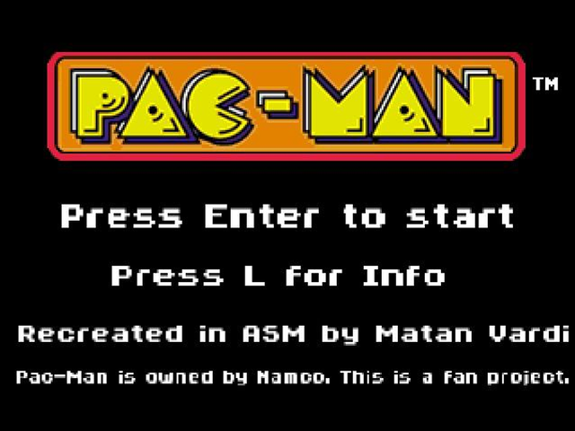&nbsp;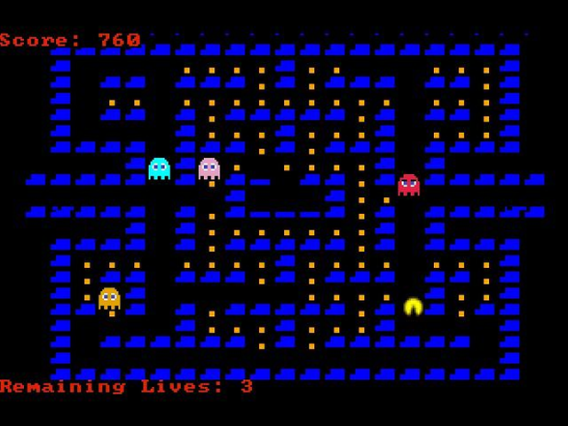
</p>

> Pac-Man is owned by Bandai Namco. This is a non-commercial fan project made for learning.

---

## About the Project

Pac-Man came out in 1980 and became one of the most popular arcade games in the world. You steer Pac-Man (a small yellow circle with a mouth) through a maze and eat every pellet while four ghosts roam the maze and try to catch you. You clear the level when all the pellets are gone, and you lose a life when a ghost catches you.

I've loved computer games my whole life, from 3D single-player games to multiplayer ones to classic 2D platformers. Building Pac-Man in a language this close to the processor felt like the best way to really understand how a game works underneath. Writing tough low-level code and watching separate algorithms and pieces of code come together into a working game was very satisfying.

The technical side focuses on:
- **Drawing pixels directly** to video memory (`A000h`) in Mode 13h
- **Careful optimization** to stay within the limits of a 16-bit CPU
- **Precise timing** of the game loop (synced to the VGA vertical retrace)
- **Keyboard input and file I/O** through BIOS/DOS interrupts, without any libraries

---

## Screenshots

<table>
  <tr>
    <td align="center"><b>Main Menu</b><br></td>
    <td align="center"><b>Gameplay</b><br>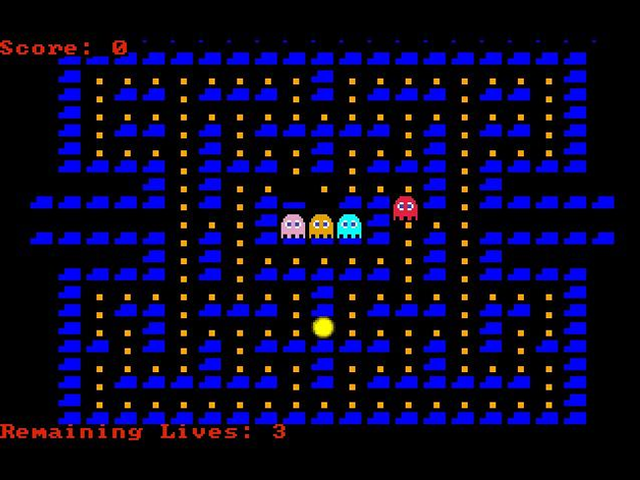</td>
    <td align="center"><b>Pause</b><br>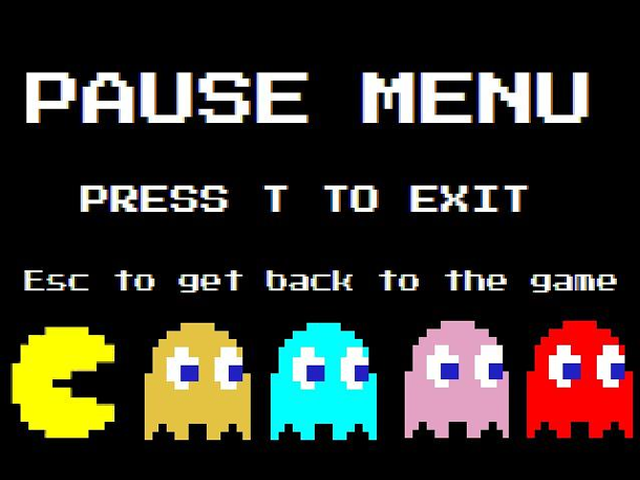</td>
  </tr>
  <tr>
    <td align="center"><b>Info</b><br>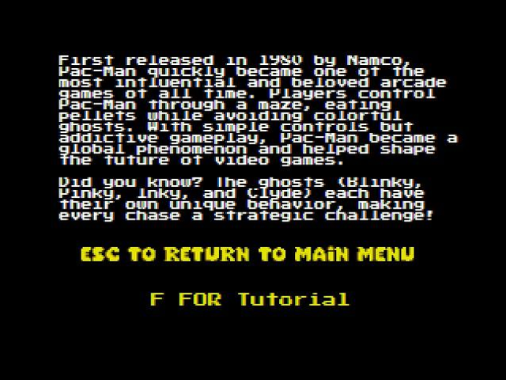</td>
    <td align="center"><b>How to Play</b><br>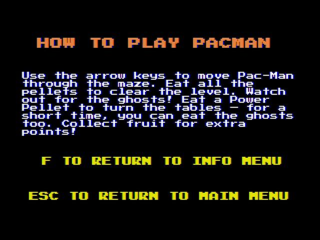</td>
    <td align="center"><b>Death Animation</b><br>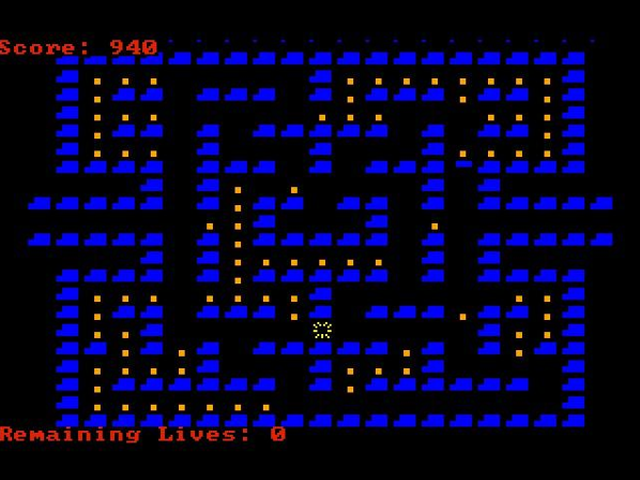</td>
  </tr>
  <tr>
    <td align="center"><b>You Win</b><br>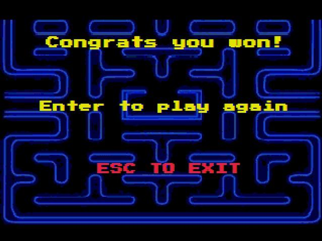</td>
    <td align="center"><b>Game Over</b><br>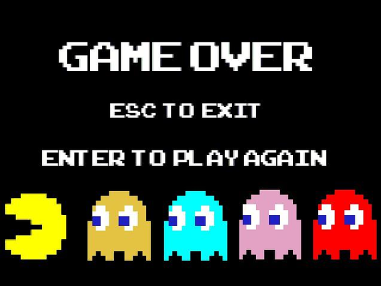</td>
    <td align="center"><b>Turbo Debugger</b><br>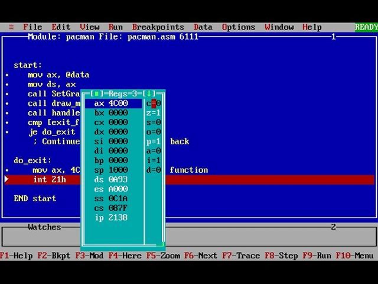</td>
  </tr>
</table>

---

## Features

- Full maze with collision detection, plus side **tunnels** that wrap around the screen
- **176 pellets** worth 10 points each. Clear all of them (1760 points) to win
- **4 ghosts with their own AI**, each with a different personality (see below)
- **Scatter / Chase modes** that switch on timers, like in the original
- **Ghost house**: Pinky, Inky and Clyde leave the house one after another
- **3 lives**, a respawn after each hit and an 8-frame **death animation**
- Animated Pac-Man sprites for all 4 directions
- **Turn buffering**: press a direction early and Pac-Man turns as soon as the path opens
- Menu, Info, How to Play, Pause, Win and Game Over screens, all loaded from BMP files

---

## Controls

| Key | Action |
|---|---|
| Arrow keys | Move Pac-Man |
| `Enter` | Start game / Play again |
| `L` | Info page (from the main menu) |
| `F` | How to Play page (from the Info page) |
| `Esc` | Pause the game / Go back / Exit |
| `T` | Exit the game (from the pause menu) |

---

## The Ghosts and Their Names

Each ghost has a different personality, and that's where their names come from. In the original Japanese version, every ghost's name describes how it behaves:

| Ghost | Color | Japanese name | Meaning | Behavior in this game |
|---|---|---|---|---|
| **Blinky** | Red | *Oikake* | "Chaser" | Targets Pac-Man's exact tile. The fastest ghost, and the only one that starts outside the ghost house |
| **Pinky** | Pink | *Machibuse* | "Ambusher" | Targets **4 tiles ahead** of Pac-Man in the direction he's moving, to cut him off |
| **Inky** | Cyan | *Kimagure* | "Fickle / Whimsical" | The most unpredictable. Uses **both Pac-Man and Blinky** to choose his target (see below) |
| **Clyde** | Orange | *Otoboke* | "Playing dumb" | Chases Pac-Man from far away, but **runs back to his corner** once he gets too close |

Fun fact: the name *Pac-Man* comes from the Japanese *"paku-paku"*, the sound of a mouth opening and closing while eating.

---

## How the Ghost AI Works

### Maze grid
The maze is stored as a **21×21 grid**, with each cell 14×9 pixels on screen. Ghosts think in grid coordinates and are converted to screen pixels only when they're drawn. Pac-Man's pixel position is converted to a grid cell (using the center of his sprite) whenever a ghost needs to know where he is.

### Choosing a direction
Each ghost moves toward a **target tile**:
1. If the ghost can keep going in its current direction, it does.
2. When it hits a wall, it compares the horizontal and vertical distance to the target and tries the **axis with the larger distance first**.
3. If both distances are equal, it uses the BIOS timer tick (`int 1Ah`) as a cheap **random number** to choose an axis.
4. Ghosts **never reverse direction** on their own, just like in the arcade.

### The math behind chasing
To chase Pac-Man, a ghost needs to know **which way to move**. Here's the idea step by step:

**1. Moving with a velocity vector.** Every frame, the ghost's position is updated by its velocity vector `V = (Vx, Vy)`:

<p align="center">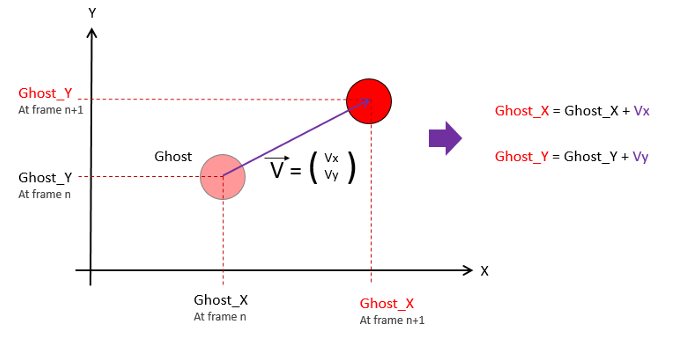</p>

**2. Splitting the velocity into X and Y.** If the ghost moves at speed `Velocity` and at some `angle`, trigonometry gives the two parts of the vector:

<p align="center">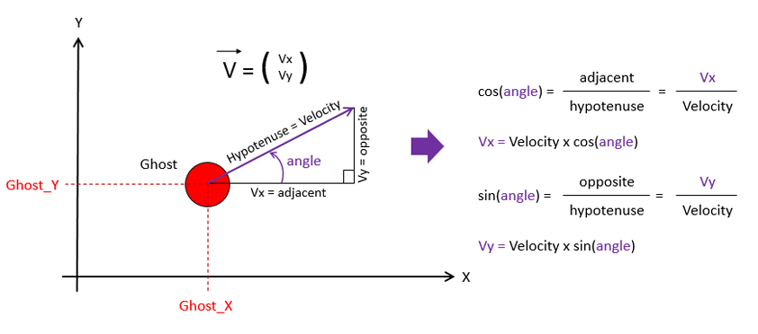</p>

**3. Finding the angle toward Pac-Man.** The angle comes from the difference between Pac-Man's position and the ghost's:

<p align="center">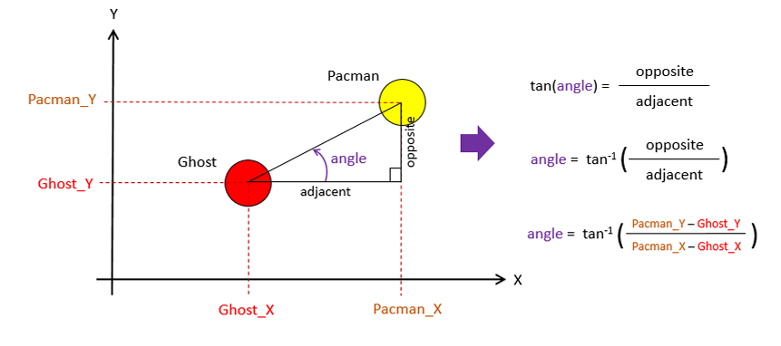</p>

Because the ghosts move on a grid and can only go up, down, left or right, the game uses a simpler version of this idea. It compares the X difference (`Pacman_X - Ghost_X`) with the Y difference (`Pacman_Y - Ghost_Y`) and moves along the axis where the gap is bigger. This avoids slow trigonometry on the 8086 but still moves the ghost toward its target.

### Scatter and Chase
Every ghost switches between two modes on a timer:
- **Scatter**: the ghost heads to its home corner (Blinky to the top-right, the others to the top-left).
- **Chase**: the ghost uses its own targeting rule:

**Blinky**: `target = Pac-Man's tile`

**Pinky**: `target = Pac-Man's tile + 4 tiles in Pac-Man's direction`

**Inky** has the most interesting rule:
```
pivot  = Pac-Man's tile + 2 tiles in Pac-Man's direction
vector = pivot - Blinky's tile
target = pivot + 2 × vector
```
In other words, Inky takes the line from Blinky to the spot just ahead of Pac-Man and extends it. When Blinky is close behind Pac-Man, Inky tries to close in from the other side, so the two ghosts work as a pincer.

**Clyde** measures his **Manhattan distance** (`|dx| + |dy|`) to Pac-Man:
- More than 8 tiles away: he targets Pac-Man directly.
- 8 tiles or closer: he gives up and retreats to the bottom-left corner.

### Speed and the ghost house
Each ghost moves only every *N* frames, so each one has its own speed:

| Ghost | Moves every | Leaves the ghost house after |
|---|---|---|
| Blinky | 5 frames (fastest) | Starts outside |
| Pinky | 9 frames | 50 ticks |
| Inky | 14 frames | 100 ticks |
| Clyde | 16 frames (slowest) | 150 ticks |

---

## Building and Running

### Tools
- **Assembler**: TASM (Turbo Assembler)
- **Linker**: TLINK
- **Emulator**: DOSBox 0.74-3
- **Editor**: Notepad++

### Steps
1. Mount the project folder in DOSBox:
   ```
   mount c c:\path\to\project
   c:
   ```
2. Build with the included script:
   ```
   make.bat
   ```
   It runs `tasm /zi pacman.asm` and `tlink /v pacman.obj`.
3. Run the game:
   ```
   pacman
   ```

> All the `.bmp` files must be in the same folder as `PACMAN.EXE`, because the game loads them at runtime.

---

## License

This project is licensed under the MIT License. See [LICENSE](LICENSE) for details.

## Author

**Matan Vardi**: [GitHub](https://github.com/MatanVardi)
